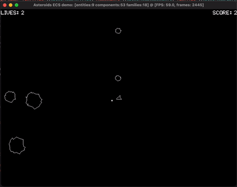
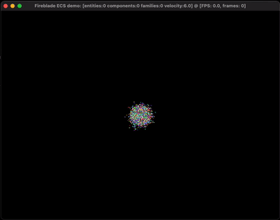

# Fireblade ECS Demo

		 

A minimal demo App for the [Fireblade Entity-Component-System](https://github.com/fireblade-engine/ecs). 
This App demonstrates handling of Entities and Components and provides a live Performance Test  for the framework.

Both demos declare their components with the `@Component` macro from the `FirebladeECSMacros` product
and use the FirebladeECS 1.4 API (`entity.set(_:)`, `entity.get(_:)`, families, entity state machines).
The particles demo also clones entities and saves and restores the whole world as a JSON snapshot.

# Getting Started

These instructions will get you a copy of the project up and running on your local machine.

## Prerequisites

- [Swift Package Manager (SPM)](https://github.com/apple/swift-package-manager)
- [Swift 6.1+](https://www.swift.org/install/), e.g. via [Xcode 16.4+](https://developer.apple.com/xcode/)
- [Simple DirectMedia Layer 2 (SDL2)](https://www.libsdl.org/download-2.0.php)
	- Download and install i.e. via [Homebrew](https://brew.sh)   
		`brew install sdl2` on macOS or `apt-get install libsdl2-dev` on Debian/Ubuntu

## Installing

1. Clone the repository 
2. Either open `Package.swift` with Xcode and run one of the executable schemes  
	-or-
3. From Terminal run `make runAsteroids` or `make runParticles` to run either demo.   
4. Run the tests with `make test`.

## Controls

| Particles | |
| --- | --- |
| `ESC` | quit |
| `c` / `r` | randomize all colors / reset all positions |
| `s`, `+`, `-`, `space` | stop, increase, reduce or reset movement speed |
| `e` / `d` | create / destroy 1 entity |
| `8` / `9` | batch create / destroy 10k entities |
| `x` | clone 1k entities |
| `k` / `l` | save / restore a JSON snapshot of all entities |

| Asteroids | |
| --- | --- |
| `←` `→` or `A` `D` | rotate the spaceship |
| `↑` or `W` | accelerate |
| `SPACE` | shoot |
| `ESC` | quit |

## Authors

* [Christian Treffs](https://github.com/ctreffs) - *Initial work*
* [Igor Kravchenko](https://github.com/igorkravchenko) - *Asteroids demo*

## License

This project is licensed under the MIT License - see the [LICENSE](LICENSE) file for details
